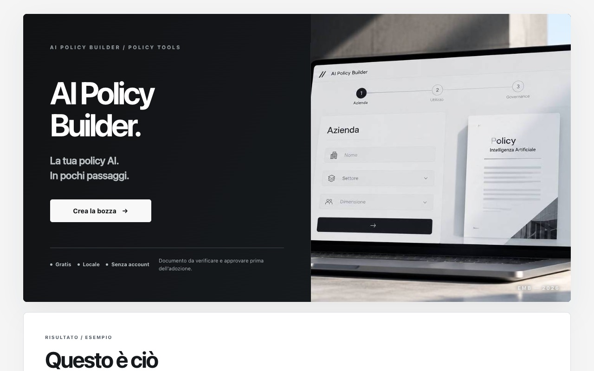

# AI Policy Builder // Client-Side EU AI Act Governance Wizard

<p align="center">
  
</p>

> **"Your company's internal AI policy draft in three guided steps."**  
> A zero-server, privacy-first web application designed for European SMEs, studios, and corporate teams to establish pragmatic guidelines for responsible AI adoption in compliance with the EU AI Act (Regulation EU 2024/1689).

[](https://emaf205.com/ideas/ai-policy-builder/)
[](https://github.com/emanuelebdc/ai-policy-builder)
[](https://github.com/emanuelebdc/ai-policy-builder)
[](https://github.com/emanuelebdc/ai-policy-builder)
[](LICENSE)

---

## ✦ The Genesis & Why This Exists

In my executive advisory and corporate training sessions across Italy and Europe, I observe leadership teams repeatedly falling into one of two dangerous extremes regarding Generative AI:

1. **The Blind Prohibition Trap**: C-level executives issue blanket bans on ChatGPT and AI models. The immediate consequence? **Shadow AI**. Employees secretly paste proprietary financial data, client contracts, and confidential source code into unvetted consumer smartphone apps over public connections without encryption or oversight.
2. **The Anarchic Wild West Trap**: Departments adopt dozens of fragmented generative subscriptions without standard procedures, exposing trade secrets, violating GDPR confidentiality mandates, and directly breaching the transparency requirements of the EU AI Act.

Neither extreme works. Organizations do not need 80-page incomprehensible legal treatises that gather dust in an intranet folder: they need a **crisp, pragmatic, 14-section internal operating policy** that employees can immediately understand, respect, and apply.

I engineered **AI Policy Builder** in Milan as a self-contained, client-side web application that guides founders, HR managers, and IT directors through essential operational choices, outputting a complete, production-ready corporate policy document in under five minutes.

---

## ✦ Visual Interface & Policy Architecture

<p align="center">
  
</p>
<p align="center"><em>Wizard interattivo in 3 fasi: profilazione aziendale, matrice degli strumenti consentiti/vietati e redazione automatica del disciplinare conforme all'EU AI Act.</em></p>

---

## ✦ The 3-Stage Guided Wizard

The application structures policy formulation into three logical milestones:

1. **Stage 1: Organization Baseline**: Company identity, industry sector, team size, operational jurisdiction, and existing confidentiality frameworks (GDPR, ISO 27001).
2. **Stage 2: AI Workflows & Tool Matrix**: Approved vs. prohibited tools (ChatGPT Enterprise/Team, Microsoft Copilot, Claude, Midjourney, local offline LLMs), classified data tiers, and explicitly forbidden activities (e.g. uploading raw customer PII or proprietary source code).
3. **Stage 3: Governance & Accountability**: Oversight roles, mandatory human-in-the-loop verification, incident management, whistleblowing procedures, and review cadences.

> **Zero Hallucination Guarantee**: If an organization has not yet decided a policy element, the wizard flags it explicitly with `[TO BE DEFINED BY MANAGEMENT]`. The software refuses to fabricate corporate commitments on your behalf.

---

## ✦ Scheda Tecnica // Technical Specifications

| Parametro | Specifica Tecnica |
|:---|:---|
| **Piattaforma di Esecuzione** | 100% Client-Side Single-File Web Application (`index.html`) |
| **Tecnologie Frontend** | HTML5 semantico, CSS modern ad alto contrasto, ES6+ Vanilla JavaScript |
| **Dipendenze Esterne** | **0** (Zero runtime Node, zero librerie npm, zero build pipeline) |
| **Quadro Normativo** | Regolamento UE 2024/1689 (EU AI Act), GDPR (Reg. UE 2016/679) |
| **Privacy e Sicurezza** | **Zero Exfiltration**: elaborazione puramente in RAM locale, zero telemetria, zero cookie |
| **Motore di Esportazione** | **DOCX** (Word pre-formattato), **Markdown** (Wiki/Notion), **PDF Print A4**, **EML** (Email staff) |
| **Struttura Documentale** | 14 sezioni istituzionali complete con matrice strumenti e blocco firme |
| **Accessibilità** | Conforme ai canoni di visione monoculare di Emanuele BDC (testo >=16px, focus visibile) |
| **Funzionamento Offline** | 100% autosufficiente; può essere salvato su chiavetta ed eseguito senza rete |

---

## ✦ I 14 Capitoli del Disciplinare Generato

1. Scopo e Ambito di Applicazione Aziendale
2. Principi Fondamentali (Sorveglianza Umana, Trasparenza, Riservatezza)
3. Classificazione dei Sistemi AI secondo i Livelli di Rischio EU AI Act
4. Matrice degli Strumenti Autorizzati, Condizionati e Proibiti
5. Classificazione dei Dati e Salvaguardie di Input (No PII)
6. Proprietà Intellettuale, Copyright e Tutela del Segreto Industriale
7. Obbligo di Verifica Umana dei Risultati (Fact-Checking & Anti-Slop)
8. Trasparenza Verso Clienti e Terze Parti (Dichiarazione Contenuti AI)
9. Protocolli di Sicurezza Informatica e Gestione Credenziali
10. Formazione Continua e Alfabetizzazione del Personale (Art. 4 EU AI Act)
11. Ruoli, Responsabilità e Supervisione dell'AI Officer Interno
12. Gestione degli Incidenti e Procedure di Segnalazione Interna
13. Cadenza Periodica di Revisione e Aggiornamento
14. Modulo di Accettazione del Personale e Blocco Firme

---

## ✦ Struttura del Repository

```text
ai-policy-builder/
├── index.html               # Web application completa autosufficiente (UI + Logica + Export)
├── assets/                  # Grafica editoriale, copertine e social preview
│   ├── social-preview.jpg   # Banner 16:9 hero ufficiale
│   ├── cover.jpg            # Artwork concettuale ad alta risoluzione
│   └── og.jpg               # Grafica OpenGraph per condivisione
├── tests/                   # Suite di collaudo e verifiche sintattiche
├── QUALITY_GATE.md          # Protocollo di controllo qualità e conformità
├── CHANGELOG.md             # Storico delle versioni
└── README.md                # Documentazione ufficiale e manifesto
```

---

## ✦ Quickstart & Esecuzione Offline

### Utilizzo Locale Diretto:
1. Clona la repository:
   ```bash
   git clone https://github.com/emanuelebdc/ai-policy-builder.git
   cd ai-policy-builder
   ```
2. Fai doppio clic su `index.html` per aprirlo in qualsiasi browser.
3. Compila i tre passaggi ed esporta il disciplinare in Word, PDF o Markdown.

### Versione Online Live:
Accedi liberamente allo strumento su:  
👉 **[https://emaf205.com/ideas/ai-policy-builder/](https://emaf205.com/ideas/ai-policy-builder/)**

---

## ✦ Nota Legale & Declinazione di Responsabilità

*AI Policy Builder è uno strumento operativo di orientamento e redazione documentale per studi e imprese, non un parere legale formale. Ogni documento generato deve essere revisionato e adattato dalla direzione aziendale o dal consulente legale prima dell'adozione definitiva.*

---

## ✦ Autore & Filosofia del Progetto

Ideato, progettato e sviluppato da **[Emanuele BDC](https://emaf205.com)** a Milano.  
Pubblicato all'interno del laboratorio indipendente **[EmaF205 Ideas Hub](https://emanuelebdc.com/ideas/)**.

Creato per promuovere un'adozione dell'intelligenza artificiale consapevole, etica, severa verso la mediocrità e conforme ai più rigorosi standard europei di sovranità digitale.

Rilasciato sotto licenza open-source **[MIT License](LICENSE)**. Libero per utilizzi personali e aziendali.
